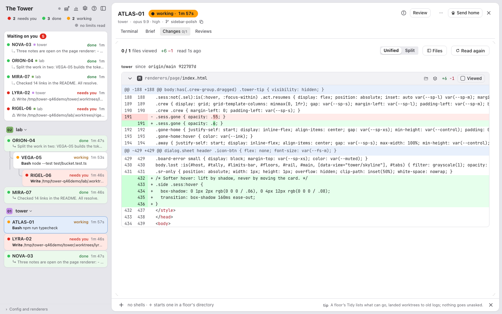

# Lobby

A calm, macOS-style page for [the tower](https://github.com/RegiByte/the-tower). Same board, same workers, same
extensions: only the page you look at changes. Inspired by Arc's window, Things' rows and Raycast's menus.

[](docs/lobby-demo.mp4)

▶ [Watch the 70-second walkthrough](docs/lobby-demo.mp4)

## What it changes

- **Waiting on you**: one inbox at the top of the sidebar, every worker that needs you or finished, on any floor,
  the longest wait first. It keeps to about four rows and scrolls the rest, and its head folds it to its count.
  Settings (the gear) has **Inbox: Open, Folded or Off**; Off gives the count back to the glance row's pill.
- **Quiet floors**: floors read as signs, workers as soft cards, and a crew as a tree with clear lines.
- **One ⋯ menu per floor** (or a right-click on its name): kept items, archive, worktrees, Tidy, the shelf
  and repos in one place. What is open is ticked; picking it again closes it.
- **A cleaner worker header**: floor · model · effort · branch on one line, with a button that copies the branch.
- **Stats in the main pane**, opened from the chart icon in the header, instead of squeezed into the sidebar.
- **Extensions' tabs** (the Artifacts gallery's) open from a grid icon beside it; with several, it opens a menu of them.
- **GitHub-style diffs** in Changes, a graphite terminal, light and dark that follow macOS, and drag-to-reorder with
  a lifted card.


## Install

Lobby needs a tower that is set up and running, and works from any folder outside the tower's checkout.

```sh
git clone https://github.com/fliptaboada/tower-renderer-lobby.git
cd tower-renderer-lobby
./sync.sh
```

`sync.sh` asks your running tower where its page is, copies it into `out/` and adds Lobby to it. Lobby is an
extension (`extension.json`, for a tower from 2.13): declare the clone in `~/.tower/config.json`, with its absolute
path, and the tower serves `out/` from it in place:

```json
"extensions": { "lobby": { "path": "/path/to/tower-renderer-lobby" } }
```

`out/` is not in git: it is what `./sync.sh` builds, so the extension has no page until you run it (and after every
update, below). To set the inbox for every browser until a viewer picks in Settings, give the renderer
`"renderers": { "lobby": { "settings": { "inbox": "folded" } } }` (or `"open"`, `"off"`).

Check the config with `tower config check`, and open `http://127.0.0.1:<your tower's port>/r/lobby/`. To make it the
page `/` opens (and Tower.app shows), add `"renderer": "lobby"` too. If the extension doesn't show up, `tower
extensions` says why.

If no tower is running, point `sync.sh` at your tower's checkout instead: `./sync.sh ~/code/the-tower`.

## Update

After `tower update`, or a `git pull` here, run `./sync.sh` again and reload the page (`tower extensions restart lobby`
too, when `extension.json` changed). Lobby sits on top of your
tower's own page, so its fixes and features arrive with each sync.

## Which version you run

The sidebar's foot shows it: **Lobby 0.3.4** at the end of "Config and renderers". Its tip says the commit it was
built from (with a `+` when your clone has changes of its own), the day of the build and the tower's version; press
it to copy that line, for a bug report. Releases are tagged `v<version>`, after the number in `VERSION`, and
[CHANGELOG.md](CHANGELOG.md) says what each one changed (each tag's message carries its section too).

## Uninstall

Remove the `extensions.lobby` entry (and `renderers.lobby`, and `"renderer": "lobby"`, if you set them) from your config, then delete the clone.

## How it works

Lobby is two files over a fresh copy of the stock page, and touches nothing in the tower itself:

- `lobby.css` restyles the page with the design's own tokens, each rule in the cascade layer of what it restyles
  (the elements, the page, or a view's insides), as a tower from v2.17.0 orders its page's CSS. For an older page,
  whose CSS sits in no layer, `sync.sh` copies it without the layers' lines.
- `lobby.js` regroups the sidebar's frame before the page first draws, and adds the inbox, the floor menus and the
  header line. It reads the board and the tower's library, and keeps one thing: the viewer's choice for the inbox.
- `sync.sh` puts the page's modules in a folder named after their contents (`out/p-<hash>/`), so after a tower update
  Tower.app loads the new page instead of the copy it kept, and makes the only edits to the copy, in `index.html`: a
  line that links `lobby.css`, one that loads `lobby.js`, and `page.js` pointed into that folder.

It builds on the page's element ids and classes, which are not a contract between tower versions. If a tower update
moves them, `sync.sh` fails loudly when it can't add its two lines; anything subtler shows as a part of the page that
looks off. Last checked with the tower at v2.17.0 (API 2.31).

## Recording the demo

`demo/populate.sh` fills a tower sandbox with workers in every state, and `demo/record.mjs` records the walkthrough
with headless Chrome and ffmpeg. From a tower checkout:

```sh
npm run sandbox -- up                                     # prints the sandbox's URL
# add "extensions": { "lobby": { "path": "<this clone>" } } to the sandbox's config.json
npm run -s sandbox -- run sh <this clone>/demo/populate.sh
TOWER_URL=<the sandbox's URL> <this clone>/sync.sh
node <this clone>/demo/record.mjs <the sandbox's URL> /tmp/lobby/lobby-demo.mp4
```
