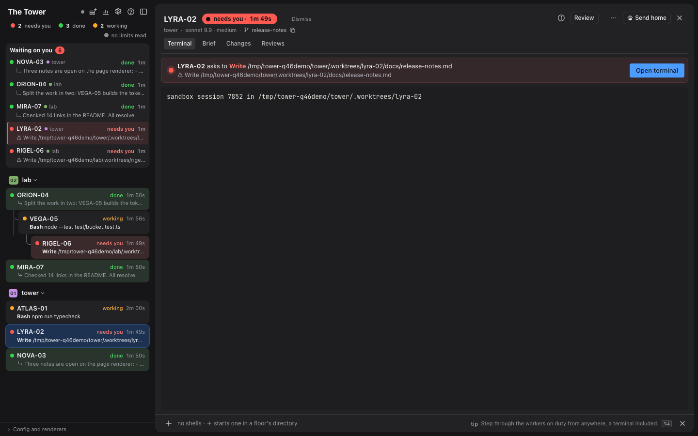

# Lobby

A calm, macOS-style page for [the tower](https://github.com/fliptaboada/the-tower). Same board, same workers, same
extensions: only the page you look at changes. Inspired by Arc's window, Things' rows and Raycast's menus.

[](docs/lobby-demo.mp4)

▶ [Watch the 70-second walkthrough](docs/lobby-demo.mp4)

## What it changes

- **Waiting on you**: one inbox at the top of the sidebar, every worker that needs you or finished, on any floor,
  the longest wait first.
- **Quiet floors**: floors read as signs, workers as soft cards, and a crew as a tree with clear lines.
- **One ⋯ menu per floor** (or a right-click on its name): kept items, archive, worktrees, Tidy, messages, the shelf
  and repos in one place. What is open is ticked; picking it again closes it.
- **A cleaner worker header**: floor · model · effort · branch on one line, with a button that copies the branch.
- **Stats in the main pane**, opened from the chart icon in the header, instead of squeezed into the sidebar.
- **GitHub-style diffs** in Changes, a graphite terminal, light and dark that follow macOS, and drag-to-reorder with
  a lifted card.



## Install

Lobby needs a tower that is set up and running, and works from any folder outside the tower's checkout.

```sh
git clone https://github.com/fliptaboada/tower-renderer-lobby.git
cd tower-renderer-lobby
./sync.sh
```

`sync.sh` asks your running tower where its page is, copies it into `out/` and adds Lobby to it. Then declare it in
`~/.tower/config.json`, with the absolute path of your clone:

```json
"renderers": { "lobby": { "root": "/path/to/tower-renderer-lobby/out" } }
```

Check the config with `tower config check`, and open `http://127.0.0.1:<your tower's port>/r/lobby/`. To make it the
page `/` opens (and Tower.app shows), add `"renderer": "lobby"` too. The tower reads the config again on its own: no
restart.

If no tower is running, point `sync.sh` at your tower's checkout instead: `./sync.sh ~/code/the-tower`.

## Update

After `tower update`, or a `git pull` here, run `./sync.sh` again and reload the page. Lobby sits on top of your
tower's own page, so its fixes and features arrive with each sync.

## Uninstall

Remove the `lobby` entry (and `"renderer": "lobby"`, if you set it) from your config, then delete the clone.

## How it works

Lobby is two files over a fresh copy of the stock page, and touches nothing in the tower itself:

- `lobby.css` restyles the page with the design's own tokens.
- `lobby.js` regroups the sidebar's frame before the page first draws, and adds the inbox, the floor menus and the
  header line. It reads the board and the tower's library, and stores nothing.
- `sync.sh` makes the only edit to the copy: one line that links `lobby.css` and one that loads `lobby.js`.

It builds on the page's element ids and classes, which are not a contract between tower versions. If a tower update
moves them, `sync.sh` fails loudly when it can't add its two lines; anything subtler shows as a part of the page that
looks off. Last checked with the tower at v2.7.2 (API 2.9).

## Recording the demo

`demo/populate.sh` fills a tower sandbox with workers in every state, and `demo/record.mjs` records the walkthrough
with headless Chrome and ffmpeg. From a tower checkout:

```sh
npm run sandbox -- up                                     # prints the sandbox's URL
# add "renderers": { "lobby": { "root": "<this clone>/out" } } to the sandbox's config.json
npm run -s sandbox -- run sh <this clone>/demo/populate.sh
TOWER_URL=<the sandbox's URL> <this clone>/sync.sh
node <this clone>/demo/record.mjs <the sandbox's URL> /tmp/lobby/lobby-demo.mp4
```
